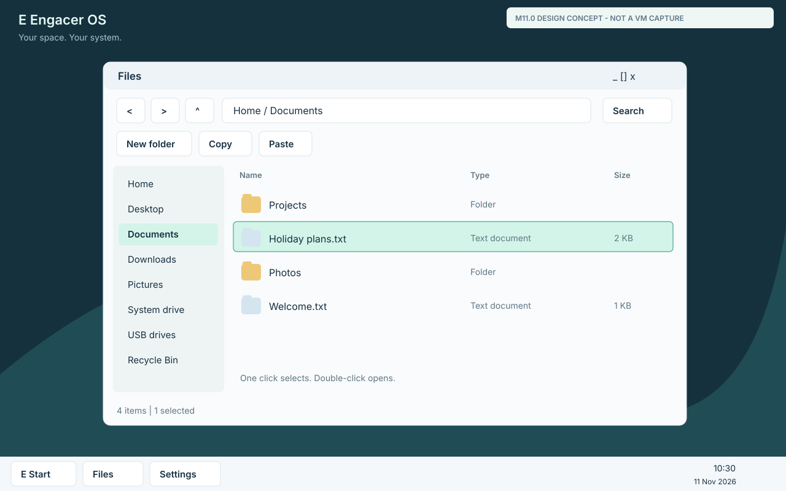
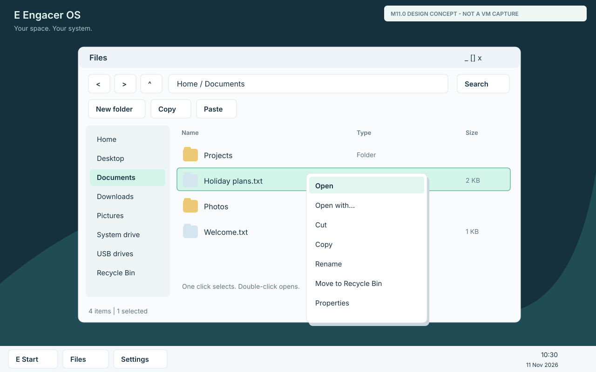
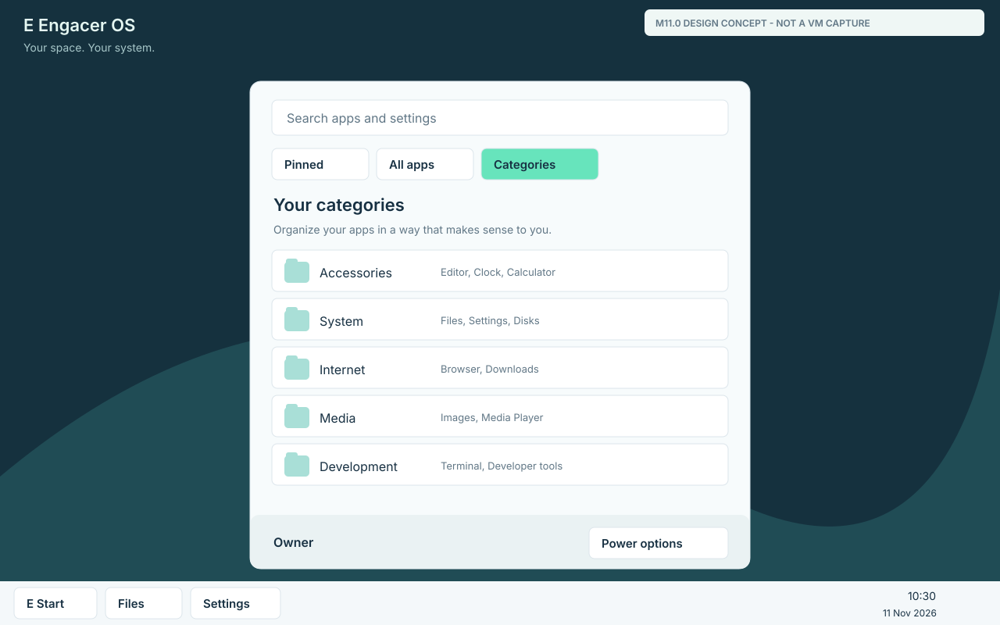
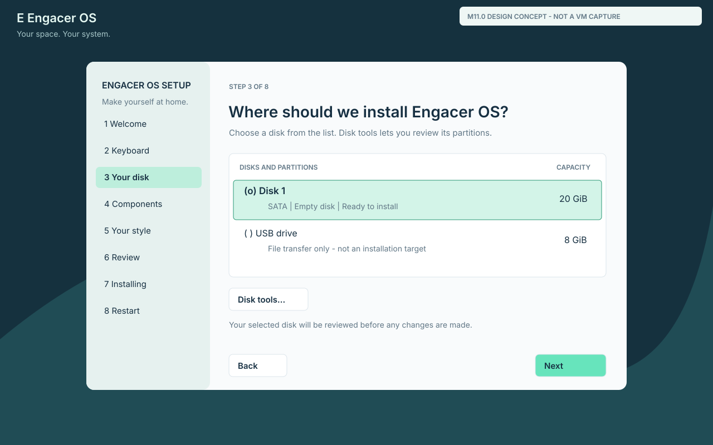

# M11 desktop and installation design contract

Status: M11.0 design baseline, 11 November 2026. Implementation follows the
[strict stage sequence](../milestones/m11.md). The original SVG screens below
describe the intended presentation; they are not screenshots of working M11 code.
M11.1 now has a separately qualified [native input implementation](input-m11.md);
the other runtime stages retain their own acceptance gates.

## Familiar behavior, original implementation

The current shell dispatches many actions on primary-button press and treats
file rows and desktop icons as immediate actions. Its launcher is a fixed app
grid. Extend the existing native shell and providers with a shared interaction
model, rather than importing a browser/electron UI or replacing the independent
kernel. Existing clipped composition, Inter coverage masks, scaling and native
volume are retained. Optional applications remain removable independently.

Microsoft's [mouse conventions](https://learn.microsoft.com/en-us/windows/win32/uxguide/inter-mouse)
distinguish selectable file/desktop objects from immediately activated menu items.
[Explorer](https://support.microsoft.com/en-us/windows/experience/fileexplorer/file-explorer-in-windows),
[Start](https://support.microsoft.com/en-gb/windows/experience/personalization/customize-the-windows-start-menu)
and [Setup](https://support.microsoft.com/en-us/windows/deployment/install-upgrade/reinstall-windows-with-the-installation-media)
provide the behavior reference. Windows assets, undocumented extensions and all
Windows system features are not inferred from this shell contract.

## M11.1 shared input contract

| Target | Primary click | Double-click | Secondary release |
|---|---|---|---|
| Files item / desktop icon | Select only | Open once | Select target if needed and open its menu |
| Empty item background | Clear selection; begin marquee after movement | No activation | Background menu |
| Button / Start result / menu command | Activate on release in the pressed control | Never run twice as a double-click side effect | Only an explicitly provided menu |
| Title bar | Focus; movement starts after threshold | Maximize/restore | Window menu |

Track press, release, button identity, target identity, elapsed time, movement
and modifiers separately. The first click is never delayed while waiting to see
whether a second occurs. Double-click requires the same target, button and a
bounded 4-logical-pixel movement radius within the chosen interval; default
500 ms, configurable from 200 to 900 ms. Crossing a 4-logical-pixel drag threshold
cancels double-click activation. A press released outside the original button
cancels activation. A right-click must never perform the primary action.

Selection is separate from hover, focus and activation. Ctrl toggles an item;
Shift extends a contiguous range from the selection anchor. Right-clicking one
of multiple selected items preserves the selection. Clicking another item
without modifiers replaces it. Escape cancels menu/drag/marquee/dialog in that
order without sending the same event to the underlying view. Pointer capture
ends safely on release, window close, disconnect or cancellation.

Enter opens the selection, arrows navigate, Tab/Shift+Tab change focus,
Shift+F10 opens the target menu, F2 renames and Delete recycles supported native
items. Ctrl+A/C/X/V select/copy/cut/paste; Alt+Left/Right navigate. Existing
keyboard providers/layouts remain functional. Shortcuts route to the focused
control first, so typing into a text field does not trigger file commands.

## M11.2 Files and context actions

One selection model serves icon/detail views. Show name, type, size and modified
information only when backed by actual metadata; do not fabricate timestamps.
Retain Home, Desktop, Documents, Downloads, Pictures, System and USB locations,
Back/Forward/Up, and add usable address/breadcrumb navigation and selection count.
View/sort choices persist. Extensions are visible; type labels follow actual data.

Menus are context-dependent and stay within the usable viewport. File/menu items
include Open, Open with, Cut, Copy, Paste, Rename, Recycle and Properties where
their provider genuinely supports them. Background menus include New folder,
Paste, View and Sort; desktop adds Personalize. Window menus offer Restore,
Move, Size, Minimize, Maximize and Close. Unsupported operations are visibly
unavailable with a reason; no offered action silently succeeds.

Native transfers stream through one reusable 4-KiB buffer, stage destination
data and publish only after verification/flush. Source deletion follows durable
destination success. Same-volume moves/renames reuse checked metadata transactions.
Directory rename/move must update descendants atomically within the native
metadata bound and refuse moving a folder into itself. Multi-item operations
report partial completion accurately; cancellation must not discard the only
copy. Collisions offer Keep both, Skip or explicitly reviewed Replace where
the provider supports safe replacement. No default overwrites a different file.

Recycle Bin is a real protected per-user store with original-location metadata,
collision-safe names, restore and explicit permanent-delete/empty review. Restore
never silently overwrites. Retain native undo information for supported completed
operations; do not claim undo for irreversible format or unsupported providers.
Desktop shortcuts are validated data records, not arbitrary commands. File
associations choose installed providers and recover from their removal.

M10 USB FAT32 remains create-only and provider-scoped: Copy/import/export and safe
remove work; no fake USB cut/delete/recycle/replace/format is added by a menu.
Native system/application paths remain protected. Existing native volume/path
limits remain explicit. A selected count beyond an operation's admitted budget
must be refused visibly, never silently truncated.

## M11.3 Start and taskbar

Start has local search, Pinned, All apps and Categories, plus Files/Settings and
power actions. Default categories: Accessories, System, Internet, Media and
Development. Users can create/rename/hide/reorder categories and pins, restore
defaults and choose list/grid/category views. Installed-app catalogue identity,
not a hard-coded list of executable paths, supplies launches and availability.
Removing an optional app removes its live entry and leaves unrelated apps intact.
Search does not spawn a process for each key or send queries to the Internet.

The taskbar separates pinned launchers from live window state, marks the active
window, restores minimized windows and offers appropriate context actions.
Default left alignment can be changed to centered. Existing eight-window
admission remains bounded; quota refusal must be visible. Do not promise a new
process/window capacity by drawing more icons. Use actual shutdown/restart paths;
sleep, lock and account switching are not offered before implemented providers.

## M11.4 visual and window system

Use original Engacer artwork with Inter typography: 16-logical-pixel body text,
14-pixel secondary labels and 28–32-pixel page headings. Core controls have at
least 36-pixel hit height, 8-pixel spacing units and visible keyboard focus.
Text is fitted/wrapped, never overlaid. Add consistent light/dark surfaces,
mint accent, restrained borders/shadows and configurable wallpaper/accent/scale.
Support 100%, 150%, 200% and existing automatic scaling with aligned hit testing.

Implement maximize/restore with saved normal bounds, edge/corner resizing,
reachable partially off-screen captions, Alt+Tab, focus ownership and left/right
snapping with a preview. Snap/restore must not forget the original bounds. A modal
dialog blocks only the appropriate owner; Escape does not close unrelated work.
Taskbar/menu/dialog geometry is recalculated for actual viewport and scale.

Keep one admitted screen composition buffer and existing fallback. Do not allocate
a 4K backing surface per window or make decorative blur a requirement. New shell
state targets at most 512 KiB retained, excluding pre-existing kernel/volume/font/
display allocations; record actual peak and retained changes separately. Reuse
one copy buffer and bounded metadata/selection storage. Coalesce motion while
preserving button edges, repaint only dirty regions and halt when idle. Effects
are optional and cannot conceal progress or consume an idle animation loop.

## M11.5 installation and first boot

Order: Welcome → Keyboard/region → Disk/partitions → Components → User/style →
Review → Installing → Restart → Installed desktop. Offer only implemented locale
options. Keep the local/offline route; no Microsoft account or network is required.
First desktop has a dismissible short guide, not a second mandatory setup loop.

Use an unmistakable bordered disk/partition list: identity, controller, capacity,
partition type, available/unsupported state, whole-row selection and clear Next.
Disk tools expose the existing supported create/delete/format operations with
target-specific review. Installation still uses the qualified whole-disk layout;
selected-partition OS installation, resize and dual boot are not invented here.
The UI must say exactly what will be erased and keep foreign disks unchanged.

Back retains choices; Next redraws only changed regions. Review names the target,
user, components and appearance. No disk writes occur before final consent.
Progress reflects real operations, with readable error/retry/recovery paths.
Ready requires actual write/readback success, then platform reset and installed
loader/kernel startup. Matching retained ISO redirects correctly; two detached
disk boots independently prove persistence. An immediate live-session desktop
never substitutes for this test.

## Why these choices

| Choice | How and why | Alternative considered |
|---|---|---|
| Shared input state | One release/selection/focus model for shell and setup avoids contradictory controls | Per-screen click hacks create duplicate activation and stale capture |
| Native shell extension | Reuse provider ownership, fonts, clipping and low-RAM behavior | A browser desktop adds runtime/RAM and does not prove OS integration |
| Provider-scoped file menus | Genuine capabilities govern available actions and failure reporting | Pretending FAT32/native/system paths have identical write semantics risks data |
| Bounded native jobs | Stream data, preserve source until success and track cancellation | Whole-file buffers and synchronous unbounded copying impair responsiveness |
| Configured appearance/catalogue | Save data preferences independently of optional app executables | Hard-coded pin paths leave stale entries after removal |
| Independent installed boots | Exercise real firmware/disk discovery and durable state | A final screenshot from the installer can mask failed installed startup |

## Stage acceptance and review

M11.1+ tests execute production code and real guest input. Inspect ordinary,
150% and actual 3840×2160 framebuffers. Review each task for clarity, convenience,
friendliness, visual quality and readability. Record memory/idle/repaint data and
host capture overhead honestly; screenshots do not prove GPU acceleration or a
human usability study. M11.6 freezes the final ISO/VMware ZIP and their exact
source/evidence hashes, then runs the full required controller/device/app matrix.

No runtime M11 requirement is marked implemented by this M11.0 document.
