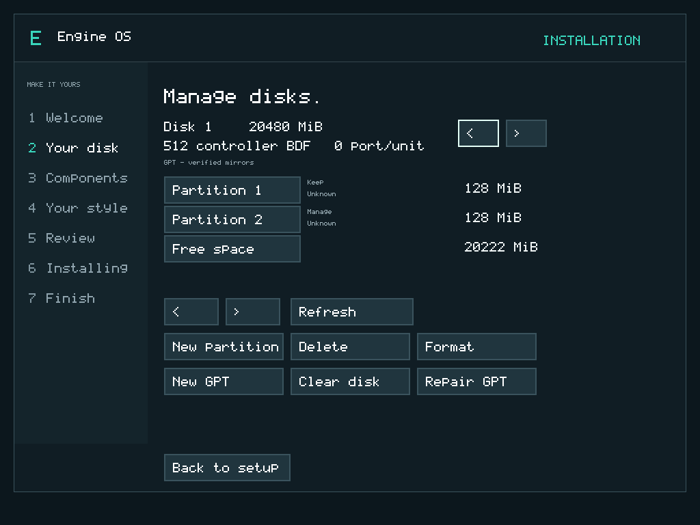

# Manage disks and partitions in Engine OS M7.1

M7.1 v0.7.1 is accepted within M71-VM-v1. The [release guide](../releases/m71-v0.7.1.md) identifies the exact ISO and checksum.

## Choose the right route

| Your goal | Choose |
|---|---|
| Install Engine OS on a previously used disk, replacing everything on it | Select the disk, turn **Erase and install** ON, then follow Next to final review |
| Prepare individual data partitions while keeping others | Select the disk, then **Manage disks** |
| Keep a working M7 installation and its documents | Use **Update** from Welcome with the M7.1 ISO; see [recovery](recovery-m71.md) |

Installation still uses the **whole selected disk**. Creating or formatting one data partition does not make it an installation target. M7.1 does not install alongside another OS. Formatting an existing partition also does not remove its partition table. You do not need to create partitions manually before normal installation.

## Open the disk manager

At Your disk, click the intended disk row, check its capacity, then choose Manage disks. Viewing, selecting, Refresh and opening a review do not write to the disk. No terminal command is required. If no row is selected, the wizard explains that you must select one.

The manager shows disk number, capacity, controller BDF and port/unit to distinguish equal-capacity disks. Upper arrows switch disks; lower arrows page through the list, four rows at a time. Switching disks refreshes the table and clears the old partition selection. Do not add/remove/resize virtual disks while the installer is open.

Rows show partition number, available name, detected format and size. **Unknown does not mean empty**: only a few signatures are recognized. GPT names are preserved; MBR has no partition-name field and uses generic primary labels. Existing Engine OS system partitions, required/read-only GPT entries and extended MBR containers are protected against individual deletion/formatting.

## Create a data partition

1. Select a Free space row, then New partition.
2. Set size in MiB. Click the field and use Backspace to replace digits, or choose Use all free. Default is 64 MiB. GPT also offers a name of up to 36 printable ASCII characters; MBR offers no name field.
3. Review creation: check disk, size and location. The new partition starts on a MiB boundary and must fit the selected contiguous gap.
4. Keep/Cancel is the safe default. Explicitly check consent, then Apply changes.

Creation makes an **unformatted** data partition. Other entries and payloads remain intact. Select the new row and Format if you need a filesystem. Primary MBR has four slots; creation of logical partitions inside an extended container is not implemented.

For an empty table on a disk with blank boot metadata, choose New GPT and review/confirm. Existing or unknown metadata must first use the separately confirmed Clear disk action if you deliberately intend to discard that layout. This is not non-destructive MBR-to-GPT conversion.

## Format a selected partition

1. Select its row, then Format.
2. Choose FAT32 or Engine data.
3. Review disk identity, partition number and first/last sector. Files on this selected partition will be lost; other partitions are retained.
4. Check consent, then Apply. Without consent Apply refuses to write. Keep/Cancel returns without writing.

FAT32 needs at least **64 MiB**. Engine data needs at least **1 MiB** with 4-KiB alignment. An empty data partition is not a bootable OS. Extra data partitions are not automatically mounted into the current desktop Files app. NTFS/ext formatting is not implemented.

These are **quick formats**: metadata becomes empty, but old file bytes can remain recoverable. They are not secure erasure. Do not interrupt an applied operation. An error can mean changes are incomplete; it does not restore old data.

## Delete, clear or repair

Delete removes only the selected ordinary entry after review/consent. It does not erase old payloads or change neighboring entries. System/required/read-only entries and extended containers refuse individual mutation. Whole-disk replacement is separate and deliberately destructive.

Clear disk removes the selected disk's boot/partition metadata at its beginning/end after confirmation. All existing partitions become inaccessible through that table. It is not secure erasure or an undoable trash operation. A normal installation can then prepare the complete Engine OS layout. Never clear another disk merely because its capacity matches.

Repair GPT is advanced. The manager validates both copies and shows verified/invalid status. Choose a valid copy, review, consent and apply to rebuild mirrors. If both valid copies disagree, there is no automatic winner: the wrong choice can hide partitions. Keep a known layout/backup before choosing. Noncanonical/hybrid layouts remain outside ordinary writable editing.

## Keyboard and limits

Tab/Shift+Tab select buttons; Enter activates; Escape cancels a pending manager action. Minimum display is 1024 × 768. Writable transport is SATA/AHCI, 512-byte sectors, up to 2 TiB; OS installation retains its 2-GiB minimum. GPT editing supports canonical 128-entry/128-byte mirrored tables; MBR editing covers primary data entries. Resize/move, conversion, secure wipe, logical-MBR editing and physical power-loss guarantees are not provided.

Device/table identity is revalidated before writes. A changed table refuses the old plan: Refresh and review again. A failed/torn edit can leave inconsistent copies requiring explicit repair. Keep the ISO. [Exact acceptance](../../evidence/M7.1/acceptance-results.json) distinguishes automated tasks from a human usability study or universal hardware support.
