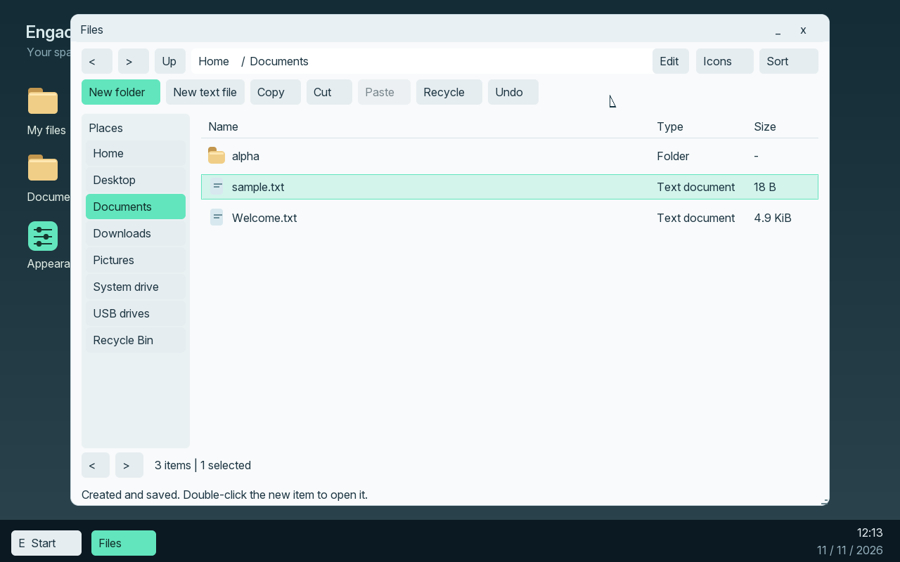
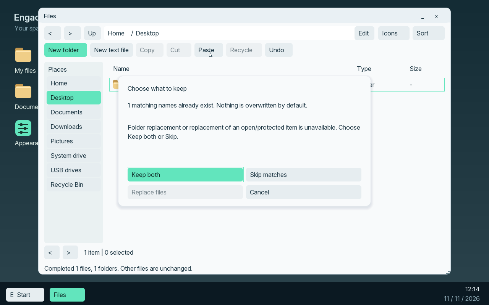
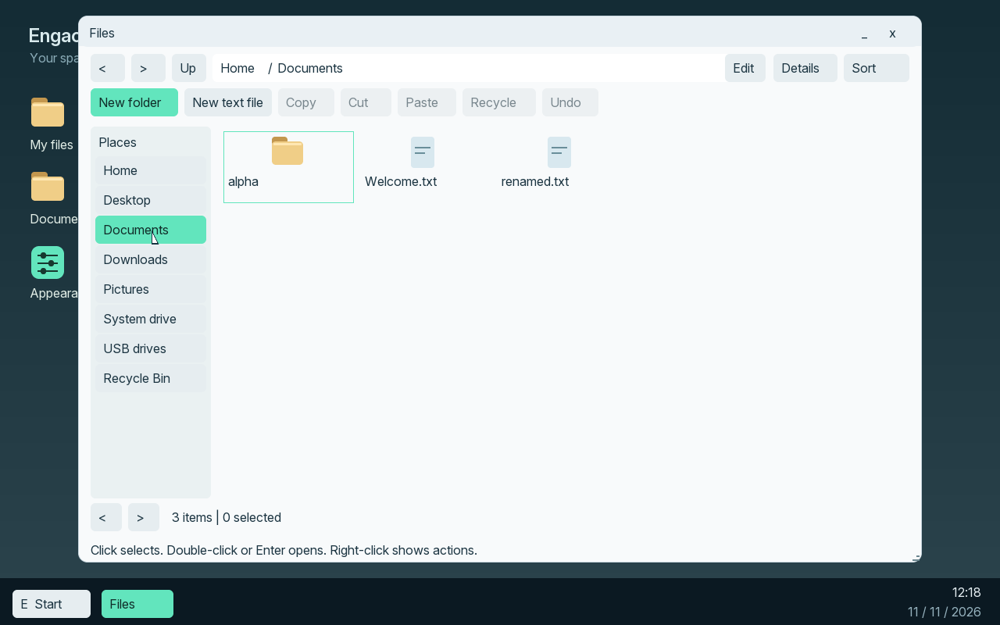

# M11.2 — Files guide

This guide describes the native M11.2 development stage, qualified by
[23 guest tasks and storage-fault checks](../../evidence/M11/2/acceptance-results.json).
These actions are included in the [M11.4 stage delivery](install-m114.md), together
with [Start/taskbar](start-m11.md) and [windows/appearance](windows-m11.md).
Older M10 ISOs do not contain them. Expanded setup and full final regression
remain M11.5 and M11.6; each stage has its own exact qualification.

## Find your files

Open **My files** from the desktop: click once to select, then double-click or
press Enter to open. Files shows a list with names, actual types and sizes.
Choose Home, Desktop, Documents, Downloads or Pictures in Places. Back, Forward
and Up change folders. On a smaller window, the Places button opens the same
choices. Click **Edit** in the address bar, enter a folder path or a name such
as `Documents`, then press Enter. Escape keeps the current folder.

Use Icons or Details to change the view, and Sort to choose name, size or type.
Folders stay grouped before files. Reverse order changes the order within those
groups. Up to 32 folder view/sort preferences are saved. File extensions remain
visible. Dates are not displayed because the current native volume does not
record reliable modification times.

## Select, copy and move

Click once to select an item. Ctrl-click toggles another item; Shift-click
extends a range. A rectangle dragged from empty folder space selects visible
items. Arrow keys move selection; Ctrl+A selects the folder's items. Enter opens
selected supported native items, subject to the eight-window limit.

Choose Copy, open the destination folder and choose Paste. Cut followed by Paste
moves native items. Ctrl+C, Ctrl+X and Ctrl+V provide the same operations. File
clipboard contents and Text Editor's text clipboard are distinct types: pasting
file paths never silently inserts them as document text.

A native directory copy includes its contents. There is one transfer at a time,
up to 128 top-level selected items and 1024 entries in the native volume. A file
is limited to 64 MiB; paths to 255 bytes and components to 63 bytes. Unsupported
selections are refused rather than silently shortened. Native copies use a shared
4-KiB buffer, read back data and publish it only after verification. Progress
separates copying from verifying. Cancel or Escape stops unfinished work; already
completed items remain and the source is kept. A group is not one atomic action.

A matching name opens a review: **Keep both** creates a separate name, **Skip
matches** preserves the destination, and **Replace files** is available only
for eligible, closed native files. There is no directory replacement or merge.
Replacing a destination is permanent; use Keep both when in doubt. No default
choice overwrites an existing file.

Drag selected native items onto a folder or uncovered desktop space to move them.
Hold Ctrl to copy. The pointer label states Copy or Move. Escape cancels capture.
Drop onto folder content or an actual folder icon, rather than a toolbar button.

## Rename, create and inspect

New folder and New text file open a naming dialog. The text file starts empty;
open it in Text Editor to write. Text Editor currently handles files smaller
than 8 KiB. On a compact window, New text file is in the background context menu.
Names currently use printable ASCII and cannot contain `/ \ : * ? " < > |`, end
in a dot/space, or exceed the supported component length.

Right-click an item, or select it and press Shift+F10. Rename (F2) changes one
native item's name. A directory rename also changes its descendant paths.
Properties shows actual provider, kind, location and file size. Unsupported or
protected actions are disabled with a reason. System/app paths cannot be changed
through Files. Close an app using an item before moving, renaming or recycling it.

Open with lists installed file handlers. Always use remembers an association for
that extension, within a 32-association bound. Removing an optional handler does
not make Files depend on it: an unavailable association falls back to another
supported handler or asks which app to use. A type label such as EXE file is not
a claim that every Windows application can run.

Create desktop shortcut stores a validated target record. A missing target or
removed app produces an explanation; arbitrary commands and shortcut chains are
not executed. Built-in launchers remain independent from user desktop files.

## Recycle and restore

Move to Recycle Bin, or Delete, moves your selected native items to a protected
per-user payload store. It records the original location before moving the
payload. Open Recycle Bin in Places, select an item and choose Restore. Restore
returns it to the original folder and asks about any name conflict. If that
folder no longer exists, copy the payload and paste it in an existing Home folder.

Delete permanently and Empty Recycle Bin require a separate review. Cancel is
the initial keyboard choice. These operations cannot be undone. One supported
completed copy, move, rename, recycle, shortcut or creation can be undone in the
current session when its target has not changed and is not in use. Batch actions,
replacement and permanent removal do not pretend to provide Undo.

## USB files and failures

The M10 FAT32 provider remains deliberately narrower: browse, copy one file to
Downloads, create-only export, Safe remove and reconnect. USB cut, overwrite,
recycle, formatting and OS installation are unavailable. Copy a USB file to
Downloads before opening it. Native and USB capabilities are shown separately.
Never unplug during a transfer; use Safe remove after a confirmed copy.

If a transfer stops, Details reports confirmed completed items and the error.
A disk acknowledgement failure can leave the complete old or complete new
metadata after restart. Writes stop and recovery is required; a failure is never
reported as a successful unchanged disk. The native stage tests include real install/restart, independently inspected
stored bytes and detached startup. Final M11 VMware qualification remains M11.6.

## Native examples

These are actual 1280x800 VM framebuffer captures from the tested M11.2 build,
not browser concepts or evidence of 4K qualification.

