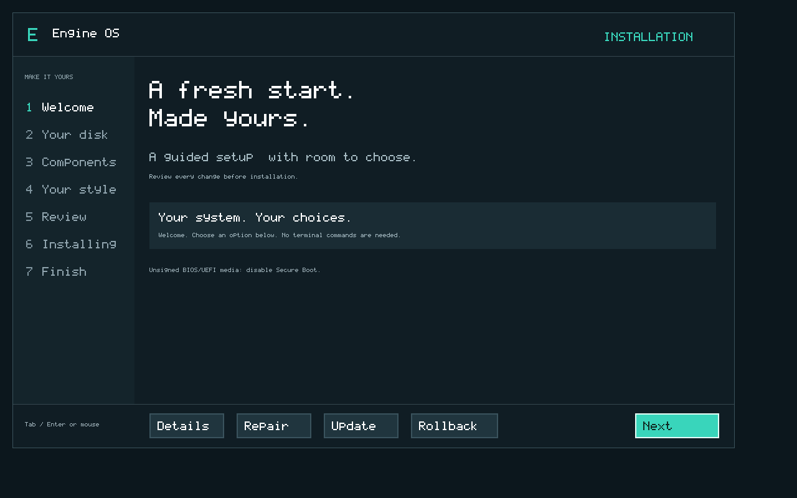
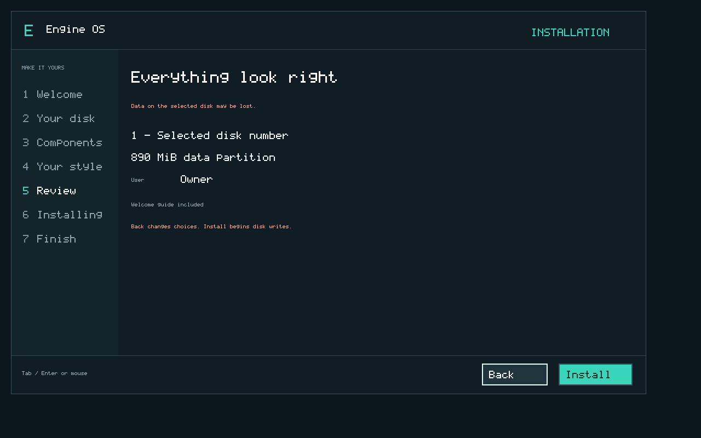

# Install Engine OS M6 in VMware

Download [EngineOS-M6.iso](https://github.com/enginsoysal/engacer-os/releases/download/m6-v0.6.0/EngineOS-M6.iso). The [release notes](../releases/m6-v0.6.0.md) and [milestone status](../milestones/m6.md) identify its qualification. Use only the exact ISO identified by the published release and acceptance report. The browser design preview is not installation media.

## Prepare the virtual machine

Create a separate x86-64 VM with two virtual CPUs, 128 MiB RAM and a **new SATA virtual disk**, preferably 20 GiB. Eligible targets start at 2 GiB and use 512-byte logical sectors. Choose either BIOS or UEFI; disable Secure Boot for these unsigned images. Connect the Engine OS M6 ISO as the CD/DVD and boot from it. A FreeBSD 64-bit VM preset is a configuration preset; the running kernel is Engine OS.

The wizard prepares the entire selected target. Do not attach a disk containing files you want to keep as an installation target. Existing unknown partitions are refused. Create another new virtual disk through VMware settings instead of deleting host partitions or running host disk utilities.

For virtual USB boot, use the separate `EngineOS-M6-usb.img` raw image. The optical ISO and raw USB image are different artifacts; do not assume the ISO is a hybrid USB image. Physical USB/hardware support is not inferred from the named VM tests.

M5/M5.1 ext2 demonstration disks are not migrated by this installer. Keep an old test disk as a backup and attach a new empty SATA target for M6. The M6 Repair/Update/Rollback actions require M6 system-slot ownership.

Do not add, remove or change virtual disks while the wizard is open. If no usable disk appears, power off, check the SATA configuration and boot this ISO again. Target hotplug is not qualified.

## Follow the graphical wizard

1. **Welcome:** choose Next. Tab/Enter and a supported USB or PS/2 mouse navigate the native interface. Details provides optional diagnostics.
2. **Your disk:** select the new SATA disk, check its capacity, then Next. The installer creates the partitions; no manual partition command is required.
3. **Components:** keep or exclude the optional Welcome guide. Base boot/storage/recovery components are required. Desktop apps such as Calculator are not shipped yet.
4. **Your style:** select the account-name field and edit it with letters, digits, hyphen or underscore. Choose an accent. These values are saved on the installed disk. The current setup has a dark presentation; a full desktop/theme system belongs to M7.
5. **Review:** inspect the selected disk, data capacity, name and guide selection. Back preserves your choices. **Install** starts writes and may destroy contents of that selected disk; ordinary Next navigation does not.
6. **Installing:** progress reports actual copied/verified stages. Keep the disk connected. A failure screen does not mean installation succeeded.
7. **Finish:** after verified completion, power off the VM, disconnect ISO/CD or USB installation media and start the VM again. Finish closes the wizard to its restart instructions; it does not automatically change VMware's boot settings.

## What appears after installed boot

The installed landing screen shows your saved name and data capacity. Change accent and Save preferences to persist it. The optional guide can be removed independently through Remove guide. This does not remove the base, Settings or other documents. **This is an installed-system landing screen, not the M7 desktop.** There are no Windows/MS-DOS application runtimes yet.

The native data partition uses the remaining aligned disk capacity, with 640 KiB of format metadata. The current profile supports 1,024 files/directories, 255-byte paths and contiguous copy-on-write file storage. It has removed the old 16-MiB volume/48-KiB-file bounds; replacement still needs sufficient free contiguous workspace. The current local user profile has no password/login authentication or multi-user security boundary.

## Optional advanced tools

Details shows build identity and managed/peak allocator usage; static kernel/volume state and firmware reservations are additional memory. Storage-test buttons create or verify `/Users/<account>/Documents/large-test.bin` over 2 MiB. They are optional diagnostics, not required installation steps.

Advanced terminal offers `help`, `menu`, `volume`, `ls`, `cat PATH`, `write PATH TEXT` and `rm PATH`. Persistent files are available after installed boot. Write/remove are limited to the user-data namespace; these diagnostics are trusted tools, not the future untrusted-application filesystem API. `menu` returns to the graphical interface. For example, with the account `Owner`, use `write /Users/Owner/Documents/note.txt Hello` and then `cat /Users/Owner/Documents/note.txt`. Paths are case sensitive.

## Recover or update

Boot the installer ISO again. Welcome offers **Repair**, **Update** and **Rollback**; select the installation disk, review the operation and Confirm. Repair restores the active verified boot bundle. Update stages this ISO's build in the inactive system slot. Rollback requires a previous valid slot. Data is preserved; these actions do not format the user volume.

If the initial installation was interrupted, restart Install on the identified incomplete target and review the whole-disk operation again. Its uncompleted setup may be recreated. A boot-version mismatch after an interrupted update needs ISO-assisted Repair; the system does not silently open user data with an uncertain activation identity. If ownership, slot or filesystem integrity cannot be established, stop and retain the disk for diagnosis. Arbitrary filesystem damage, format migration and physical power-loss recovery are not promised.

[Recovery and update instructions](recovery-m6.md) · [Storage/recovery design and limits](../architecture/storage-m6.md) · [Distribution recipes](distributions.md) · [Wizard design history](installer-design.md).
