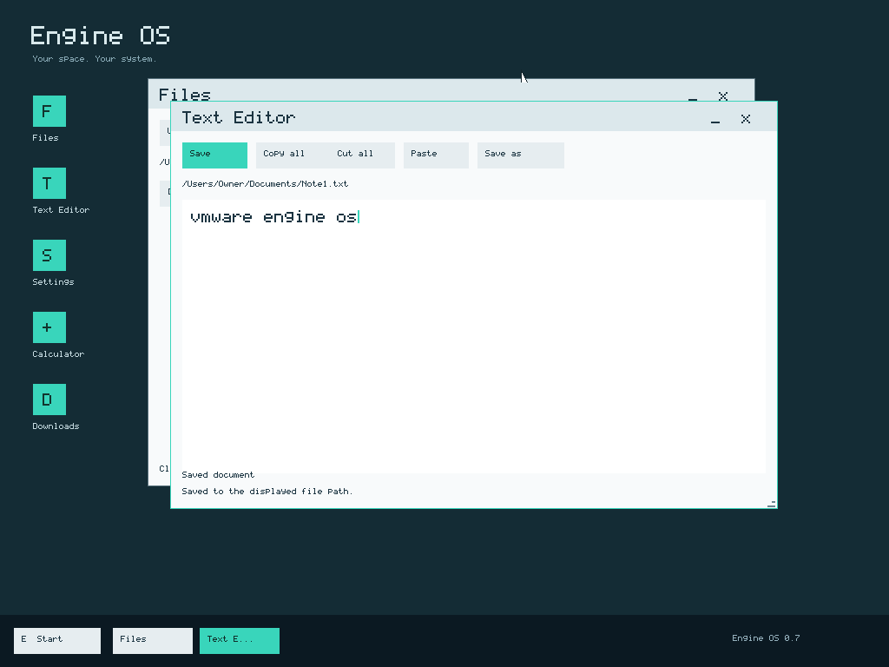

# Install Engine OS M7 in VMware

M7 v0.7.0 is accepted within M7-VM-v1. Use the exact ISO and SHA-256 in the [release guide](../releases/m7-v0.7.0.md).

## Prepare VMware

1. Download [EngineOS-M7.iso](https://github.com/enginsoysal/codename-engine-os/releases/download/m7-v0.7.0/EngineOS-M7.iso) from the official release. Compare its SHA-256 with the release guide using `Get-FileHash -Algorithm SHA256 .\EngineOS-M7.iso` in PowerShell.
2. Create a separate x86-64 VM. A FreeBSD 64-bit preset is suitable; this preset does not make Engine OS FreeBSD. Use **two vCPUs, 128 MiB RAM and a new 20-GiB SATA disk**. Eligible installation disks use 512-byte logical sectors and start at 2 GiB. Use BIOS or UEFI with **Secure Boot disabled**.
3. Attach the ISO as CD/DVD and connect it at startup. The ISO opens the graphical installer. The desktop appears after installation and a disk-only restart.
4. For downloads, use a connected **Intel e1000e** adapter with **NAT**. Do not use vmxnet3 or legacy e1000 for this release. The host CPU must expose RDRAND, and the virtual clock must have correct UTC. Offline desktop tasks still work without networking.

VMware normally creates the PCIe bridge for e1000e. If your preset chooses a different adapter, power off the VM, close its configuration, back up the VM's `.vmx` file, then set the following keys in that file. Replace existing definitions rather than adding duplicate keys. Let VMware manage its generated MAC address; do not copy a test MAC into multiple VMs.

```text
ethernet0.present = "TRUE"
ethernet0.virtualDev = "e1000e"
ethernet0.connectionType = "nat"
ethernet0.startConnected = "TRUE"
pciBridge0.present = "TRUE"
pciBridge4.present = "TRUE"
pciBridge4.virtualDev = "pcieRootPort"
pciBridge4.functions = "8"
```

The tested hypervisor is VMware Workstation 26.0.1 build 25688693. Other devices/hypervisors are not automatically qualified. Keep installation targets separate from disks containing personal files. No manual partition command or external disk tool is required.

## Next, customize, review, install

1. **Welcome:** choose Next. Tab, Shift+Tab and Enter or the supported mouse operate the wizard. Details is optional.
2. **Your disk:** select the new SATA disk, confirm its capacity, then Next. Unknown existing partitions are refused rather than silently erased.
3. **Components:** keep or omit Calculator and the Welcome guide. The desktop and Text Editor are required. These switches affect the actual installed files.
4. **Your style:** choose the local account name and accent. Back preserves your choices. Distribution defaults supply additional desktop appearance; Settings can change dark/light and accent later.
5. **Review:** inspect the disk, data capacity and choices. Install is the explicit write action. The installer creates GPT, BIOS/EFI boot resources, two system slots and a native data partition using the remaining aligned space.
6. **Installing:** wait for verified copy progress and the successful Finish screen. An error is not a completed installation.
7. **Finish:** power off, disconnect the ISO and start the VM again. Boot the installed SATA disk. You should now see the real **Engine OS desktop**, with Files, Text Editor, Settings, optional Calculator, Downloads and Start.



## Your first five minutes

Open Text Editor, type a note and choose Save as. Pick a name, save, then open it in Files. Drag the title bar, resize the bottom-right corner, minimize and restore through the taskbar. Open Settings, choose an appearance and Save preferences. Restart without the ISO and reopen your note. These are real installed-volume operations.

Open Downloads with NAT connected. Keep the default HTTPS address and choose Download. Wait for Completed, then Open Downloads. The public Engine OS license is saved as `Download1.bin`; subsequent files receive unique names. This first download is deliberately small. Never bypass a certificate or invalid-clock error. See [desktop controls and limitations](desktop-m7.md).

## If something is missing

- Installer appears again: disconnect the ISO and boot the installed SATA disk.
- No target disk: power off and check that the new disk uses SATA/AHCI, not NVMe/SCSI. Do not hotplug disks while the wizard is open.
- No network: check e1000e, NAT and Connected. Open Downloads and Retry network. Unsupported routing produces a readable error; a decorative connection icon is not proof of working networking.
- Secure download refused: check UTC, RDRAND availability and the displayed error. M7 has no proxy, Wi-Fi, captive-portal or IPv6 setup.
- Calculator absent: it may have been omitted deliberately. Settings can install it from the offline package cache.

Use the matching ISO for Repair, Update and Rollback. The [recovery guide](recovery-m7.md) is retained for M7 system slots; choose the M7 ISO, not an older layout. The M7 maintenance test updates to the separately built Night kernel, rolls back, deliberately damages its own BIOS test payload and repairs it while independently verifying the complete data partition remains unchanged. This does not qualify arbitrary app/data migrations. Earlier M5/M5.1 data layouts are not migrated.

Original MS-DOS and Windows applications do not run yet. Their separate compatibility tracks are M8.
