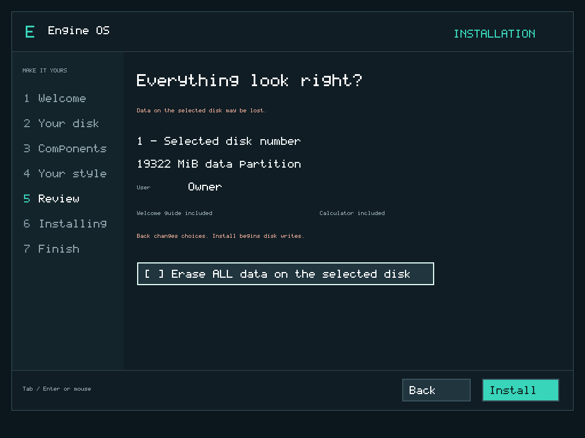

# Install Engine OS M7.1 in VMware

M7.1 v0.7.1 is accepted within M71-VM-v1. Use the exact tested ISO and SHA-256 in the [release guide](../releases/m71-v0.7.1.md).

Download [EngineOS-M71.iso](https://github.com/enginsoysal/engacer-os/releases/download/m71-v0.7.1/EngineOS-M71.iso). Compare `Get-FileHash -Algorithm SHA256 .\EngineOS-M71.iso` with the published SHA-256. Download the accompanying third-party notices. The optical ISO and raw `EngineOS-M71-usb.img` are different artifacts.

## VMware settings

Use a separate x86-64 VM, **two CPUs, 128 MiB RAM and a 20-GiB SATA disk**, with 512-byte logical sectors. Choose BIOS or UEFI and **disable Secure Boot** for unsigned public media. A FreeBSD 64-bit preset selects virtual hardware, not a FreeBSD kernel. Keep at least a 1024 × 768 display for disk management.

For downloads use connected e1000e with NAT, RDRAND exposed and correct virtual UTC. The [M7 adapter instructions](install-m7.md#prepare-vmware) explain its PCIe bridge. Legacy e1000/vmxnet3 are not qualified. Offline installation/document tasks need no networking.

## Follow the wizard

1. Welcome: Next. Repair, Update, Rollback and optional Details remain available.
2. Your disk: click the intended row and check capacity. A new disk can continue with Next. To deliberately replace a previously partitioned disk, turn **Erase and install** ON. For individual data operations choose [Manage disks](disk-manager-m71.md).
3. Components: select optional guide and Calculator. Desktop, Files and Editor are required. Back preserves choices.
4. Your style: choose local name and accent.
5. Review: check the selected disk, capacity and choices. Replacement requires checking **Erase ALL data on the selected disk** before Install. Without consent Install writes nothing. Selection, enabling replacement and earlier navigation do not erase it.
6. Installing: wait for actual verified progress. Keep the disk connected. An error is not success; retain the ISO.
7. Finish: power off, disconnect the ISO and restart from SATA. The real desktop appears with Files, Editor, Settings, optional Calculator and Downloads.

The installer creates GPT, BIOS/EFI boot resources, two system slots and a native data volume using remaining aligned capacity. It replaces the whole selected disk, not an existing single partition. Use [Update](recovery-m71.md) to retain a compatible working M7 installation.

## If the disk is not empty

The old M7 installer refused this. M7.1 offers explicit management or replacement. **Formatting one partition does not make the disk blank** and is not required before whole-disk installation. Normally select the disk, enable Erase and install, then review/consent and Install. Existing unknown contents are never silently accepted as empty.

If no usable target appears, power off and check SATA/AHCI and capacity. NVMe/SCSI/USB writes are outside this release. Do not hotplug or resize disks during the wizard. With equal-capacity disks check controller/port; native tests verify formatting disk 2 leaves every byte of disk 1 unchanged.

Create/save/reopen a note, change Settings and restart without ISO. [Desktop controls](desktop-m7.md), [distribution customization](distributions.md), [recovery](recovery-m71.md). Original DOS/Windows program execution remains M8.
