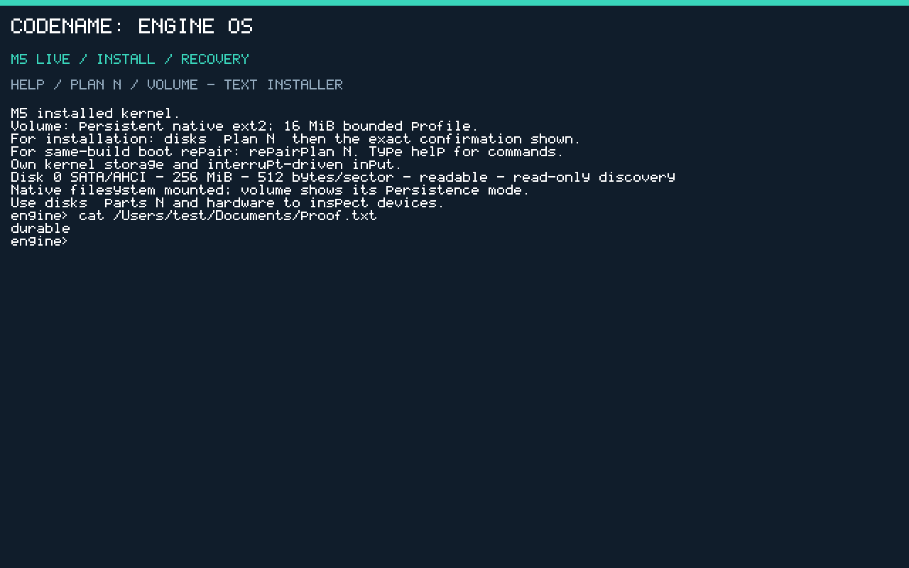

# Install Engine OS in VMware

**M5 reference / M5.1 advanced workflow.** For normal use, follow the [M5.1 guided-menu tutorial](install-m51.md); terminal commands are optional.

This tutorial is for **M5 v0.5.0**, a text-based native installer. There is no desktop or Windows application execution yet. Use a new disposable VM and disk. The current writable native volume is 16 MiB, with a 48-KiB file limit; most of a 20-GB disk remains unallocated.

## 1. Download and verify

Download `EngineOS-M5.iso`, `M5-SHA256SUMS.txt` and `m5-build-manifest.json` from the [official M5 release](https://github.com/enginsoysal/engacer-os/releases/tag/m5-v0.5.0). Verify the ISO in PowerShell:

```powershell
Get-FileHash .\EngineOS-M5.iso -Algorithm SHA256
```

Compare all 64 hexadecimal characters against the checksum file. Keep the ISO available for recovery. Historical M4.5 downloads do not contain this installer.

## 2. Create the VM

1. Create an x86-64 VMware VM. The FreeBSD 64-bit profile is acceptable as a virtual-hardware preset; Engine OS supplies its own kernel.
2. Select **two CPUs**, **128 MiB RAM**, UEFI or BIOS firmware, and **Secure Boot disabled**. The public ISO is unsigned.
3. Add a **new SATA hard disk**, at least 256 MiB. A new 20-GB SATA disk is a suitable manual test target. Do not attach a physical/raw host disk or a disk containing files you need.
4. Connect `EngineOS-M5.iso` to CD/DVD and enable **Connect at power on**. Boot from CD/DVD. If necessary, select it in VMware's boot menu.
5. Expect `M5 LIVE / INSTALL / RECOVERY` and an `engine>` prompt. The live native filesystem is temporary RAM storage.

SCSI/LSI disks selected by some VMware presets are not supported install targets. NVMe, IDE/ATA, VirtIO and USB read discovery does not mean M5 can install to them. Choose SATA explicitly.

## 3. Inspect and confirm

```text
disks
plan 0
```

Replace `0` with the actual SATA disk number. Check the PCI identity, port and capacity printed by the plan. It proposes a GPT disk, BIOS boot area, 64-MiB EFI partition and 16-MiB native data partition. Other capacity remains unallocated. Planning performs no writes.

The plan prints the exact confirmation, for example **only for a 256-MiB disk**:

```text
install 0 ERASE-524288
```

For a 20-GB disk the sector count is different: type the command shown by your own plan. The confirmation is case-sensitive. Use `cancel` to abandon it. An existing partition table or nonblank reserved boot metadata is refused; there is no force/erase override in M5. A refused disk must not be formatted merely to work around an unsupported controller.

Run the exact confirmation. Expect `M5_INSTALL_PASS`, `Verified`, and installer status `0`. Wait for the prompt. Any nonzero status means the operation failed; do not treat a partially written disk as installed.

## 4. Boot the installed system

1. Power off this VM through VMware. `halt` stops CPUs but does not power off VMware.
2. Disconnect the ISO/CD/DVD at power-on. If using USB live media, disconnect it too.
3. Boot the SATA hard disk. Expect `M5 installed kernel` and `Volume: persistent native ext2`.
4. Try:

```text
write /Users/test/Documents/hello.txt Hello
cat /Users/test/Documents/hello.txt
volume
```

Power off and boot again without the ISO; `cat` must still print `Hello`. Writes made earlier in the live environment are intentionally absent from the installed filesystem.

The qualified QEMU UEFI profile shows the installed volume and a file retained across boots below. VMware uses the same text console; firmware resolution can differ.



## If something differs

Use [troubleshooting and recovery](recovery.md) and the [M5 command reference](m5-console.md). Record firmware mode, controller, complete `disks`/`hardware` output and the exact status. Reattach the same-release ISO for boot repair. Do not repeatedly attempt destructive actions on an unidentified disk.
