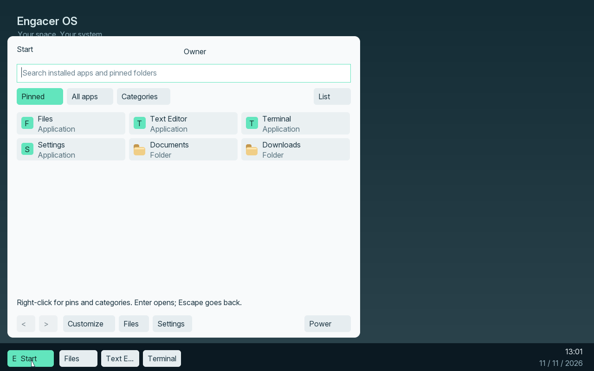
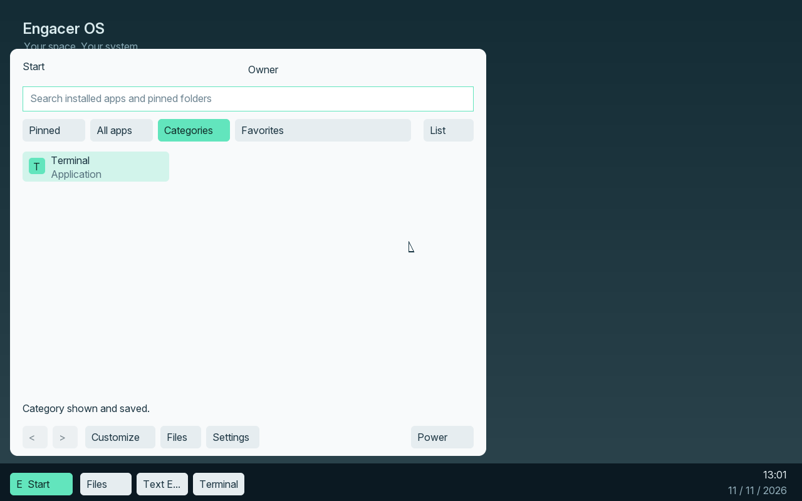
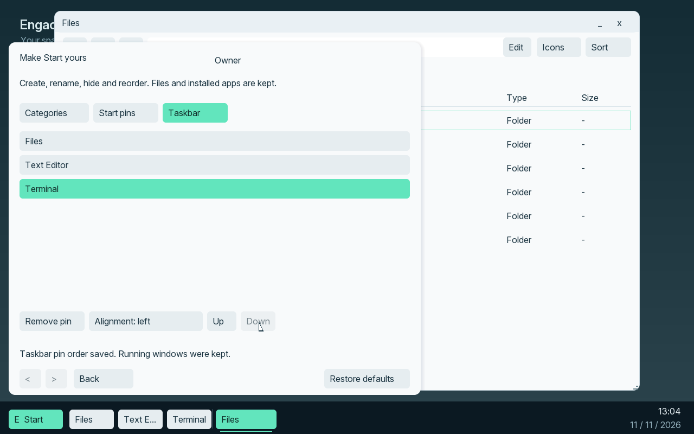
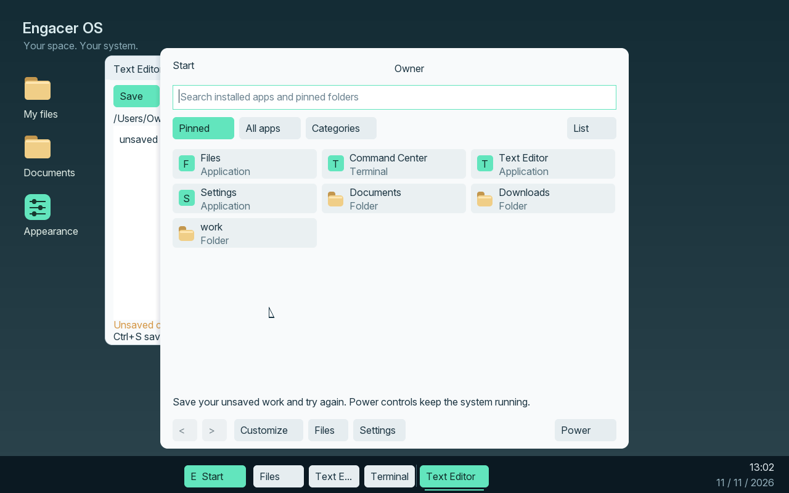

# M11.3 — Start and taskbar guide

This guide describes the M11.3 development stage, with
[22 native tasks and exact-source acceptance](../../evidence/M11/3/acceptance-results.json).
The controls are included in the [M11.4 stage delivery](install-m114.md), with
[windows/appearance](windows-m11.md). Older M10 ISOs do not contain them.
Expanded setup and full final regression remain M11.5 and M11.6.
[M11 stage order](../milestones/m11.md).

## Open an app

Click **Start**, press either Windows key, F10 or Ctrl+Escape. Type part of an
installed app's name, then click its result or press Enter. Search stays on this
device. It searches native app names and pinned-folder labels, not file contents
or the Internet. Windows Apps opens the existing, separately qualified original
Windows-app profile; general Windows compatibility is not added by this menu.

Pinned contains your shortcuts. All apps lists the installed native catalogue.
Categories groups those same apps. Start items launch with one click. Files and
desktop items still select on one click and open on double-click or Enter.
Use the page arrows when there are more entries. List/Grid changes the view.
Files and Settings also have direct buttons at the bottom of Start.

Arrows choose results, Enter opens, Tab/Shift+Tab moves between controls and
Shift+F10 opens the selected item's context menu. Escape clears a search, goes
back from customization, or closes Start. A click outside closes Start without
opening a covered desktop item.

## Make categories yours

Choose **Customize → Categories**. Select a category, then Rename, Hide/Show,
Up or Down. New category creates one; names use 1–31 printable ASCII characters,
without leading/trailing spaces. Up to twelve categories are supported.

Right-click an app in Start and choose **Move to category...** to assign it.
Hiding a category keeps its apps in All apps, search and existing pins. Show it
again in Customize when needed. Categories do not install or remove programs.
Choices save automatically; a failed save gives an explanation instead of
claiming that the change will survive restart.

## Pins are shortcuts

Right-click an installed app and choose Pin to Start or Pin to taskbar. Unpin
changes only the launcher. To pin a native folder, right-click it in Files and
choose Pin folder to Start. A folder pin opens the real folder; it does not copy
its contents. Moves/renames through Files update that pin. Recycling removes
the pin; after restoring the folder, pin it again if wanted. A folder changed
outside Files may become unavailable and can be unpinned safely.

**Customize → Start pins** offers Rename, Remove, Up and Down. A custom pin name
does not rename the app or folder. Start accepts up to 32 pins. USB folders and
recycled payloads are not pin targets in this stage.

**Customize → Taskbar** changes pin order, removes a selected pin and chooses left
or centered alignment. The taskbar accepts eight app pins. Its pin labels come
from the installed-app catalogue. A narrow screen can show a Pins overflow menu.

## Open windows stay separate

Taskbar launchers and open-window buttons are separate groups. A pin launches
its app, or restores/minimizes its most recent open window. A window button acts
on that specific window. The active window is highlighted; running and minimized
windows have different indicators. A Windows overflow menu keeps windows
reachable when there is insufficient space.

Up to eight windows can be open. A ninth attempt explains the limit and keeps
your current work. Close a window and try again. Removing an optional app through
Software Manager removes its Start/taskbar pins and search result. Files,
Settings and other apps continue working. Reinstalling restores availability;
it does not silently recreate deleted custom pins.

Restore defaults opens a separate review and initially selects Cancel. Confirming
resets categories, pins, view and alignment. It preserves files and installed apps.

## Restart or shut down

Save your work, then choose **Power → Restart...** or **Shut down...** and review
the action. Cancel is initially selected. Unsaved documents, active transfers,
installation jobs, a read-only system volume or an unconfirmed cache flush keep
the session running with an explanation. There is no silent discard.

Restart performs an actual platform reset and installed startup. Shutdown is
available only for a recognized virtual firmware profile with the implemented
ACPI provider; otherwise the menu item is disabled. Physical shutdown, general
firmware-method evaluation, sleep, lock and account switching remain outside this
stage. [Implementation and limits](../architecture/start-m11.md).

## Native examples

Actual 1280x800 guest framebuffers, not browser concepts or 4K qualification:

