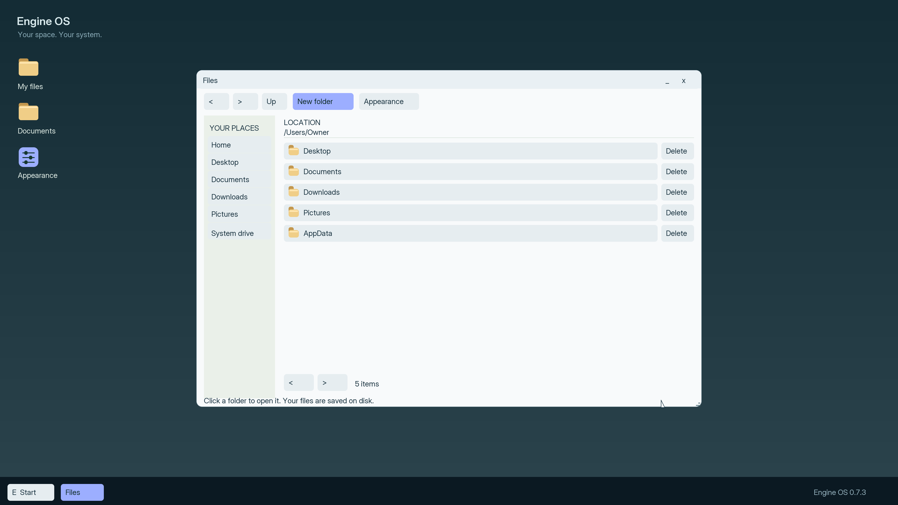

# Engine OS M7.3 — smooth native UI and HiDPI

M7.3 is qualified within **M73-VM-v1**. It replaces the ordinary pixel-enlarged
UI lettering with native-size antialiased Inter text, refreshes the installer,
disk/recovery screens and folder desktop, and provides saved display sizing.

[Prepared VMware ZIP](https://github.com/enginsoysal/engacer-os/releases/download/m73-v0.7.3/EngineOS-M73-VMware.zip) ·
[Standalone ISO](https://github.com/enginsoysal/engacer-os/releases/download/m73-v0.7.3/EngineOS-M73.iso) ·
[All assets and SHA256 file](https://github.com/enginsoysal/engacer-os/releases/tag/m73-v0.7.3).

## Start here

Extract the whole VMware ZIP and open EngineOS.vmx. It contains a new blank,
growable 20-GiB SATA disk and the matching ISO. Follow Next, select the disk,
review and Install, then choose Open desktop. Your actual installed folders
open immediately. To test later disk startup, power off, disconnect only CD/DVD
and keep the SATA disk connected. [Step-by-step guide](../handbook/install-m73.md).

Existing compatible M7.2 installations can use graphical Recovery/Update to
retain personal files. Keep the ISO for recovery. Whole-disk Erase and install
is a separate destructive operation, requiring explicit consent.
[Recovery and rollback](../handbook/recovery-m73.md).

## What changed

- Smooth Inter text at actual physical sizes, measured fitting/wrapping,
  semantic typography, rounded controls and consistent spacing.
- Clear setup, disk management, review, progress, recovery and failure layouts.
  A real disk-write failure exposes working Details and safe return routes.
- Real Files desktop with the existing persistent folder tasks, readable
  personal text and light/dark appearance. Existing text opens at its beginning.
- Auto, 100%, 150% and 200% display size, shared with pointer hit testing;
  unsuitable sizes are refused. Saved sizing falls back to Auto on a smaller
  framebuffer. Supported distribution profile branding/content is retained.
- Only the changing installation progress region is repainted; no idle animation
  or full-screen backing buffer per window. The fixed coverage atlas is 220,492
  bytes; allocator, kernel span and video framebuffer measurements are separate.

## Exact identity

| Item | Value |
| --- | --- |
| Build | `8bf85110f7ac5a7ee48a824c3cc609dd` |
| Native source commit | `798d577428057c86e215583c1f9bf8d875ce6fef` |
| ISO SHA256 | `1b7979bafa52470614e72ea8c46848a52d02e4158ae6c633279f3e8debc3e9cc` |
| VMware ZIP SHA256 | `c69ed1733fb8ece09001dca0bf56a622efa91b3e2a626c32dd072a9fe776b263` |
| Acceptance scope | M73-VM-v1 |

[Exact acceptance](../../evidence/M7.3/acceptance-results.json),
[reproduction and proof](../../evidence/M7.3/README.md),
[graphics decisions](../architecture/graphics-m73.md),
[five-question design review](../architecture/usability-review-m73.md).

## Qualified checks and limits

Seventeen gates comprise fifteen runtime/host tasks, repository checks and the
structured agent design review. Native task profiles cover BIOS 1024×768 and
UEFI 1280×800, 1920×1080, 2560×1440 and 3840×2160, including a 64-MiB guest at
1280×800. VMware Workstation UEFI/BIOS and the exact public starter ZIP undergo
real installation, folder creation and two unforced same-VM disk restarts with
retained NVRAM. Personal files survive update and actual older-slot rollback.
Format/erase refusal, unrelated-partition preservation, real SATA write EIO,
missing/small disks, font-license bytes and saved display settings are checked.
Folder tasks retain zero extra managed pages and repainting stops at input
idle, with both guest CPUs halted. Configured guest RAM is not total kernel
consumption; see the measured categories in acceptance.

The 4K proof is a real framebuffer, not an enlarged screenshot. Mode availability
still depends on UEFI GOP/firmware; the qualified OVMF fixture sets its ordinary
preferred-resolution variable. Active EDID selection has separate host protocol
contracts, not physical-monitor qualification. No post-boot mode switching,
hotplug, multi-monitor, arbitrary GPU, Raspberry Pi/ARM or factory Secure Boot
qualification is claimed. Disable Secure Boot for this unsigned development
media. A human/novice usability study has not been conducted. ASCII and three
explicit scale choices remain bounded. Original DOS/Windows execution is M8
and is not implemented by this release.

The original OS code remains MIT. Inter is distributed under SIL OFL 1.1;
download the full THIRD-PARTY-NOTICES file with the binaries. The full font
license is included in the kernel/installer and VMware package and written to
System/Licenses on fresh installation. Prior release assets and accepted proof
remain unchanged.
