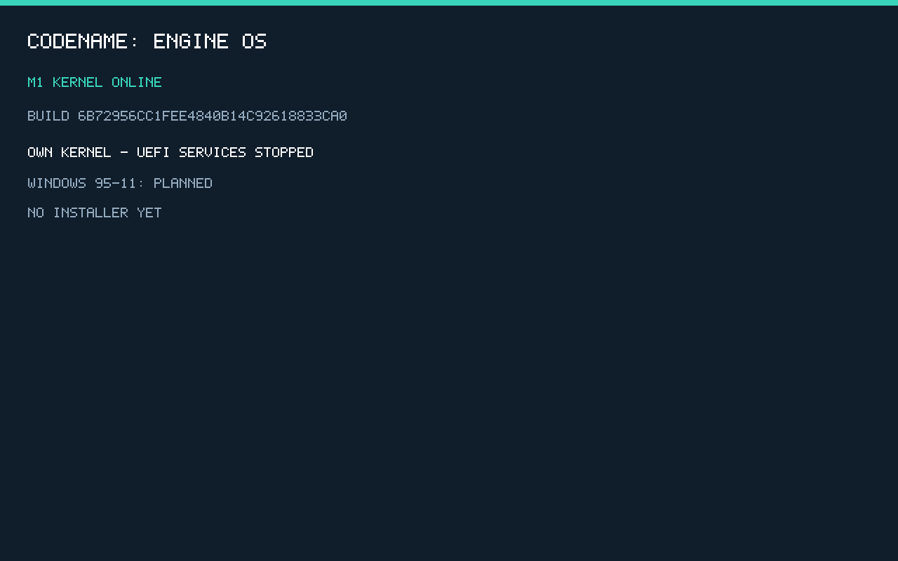

# M1 — acceptatiebewijs

De volledige verse suite staat in [acceptance-results.json](acceptance-results.json). De [buildmanifest](build-manifest.json) koppelt bronhashes en artefacten aan één build-id. Scope: eigen kernelboot en diagnostiek op de gepinde QEMU/UEFI-configuratie; geen installer of appcompatibiliteit.

## Uitgevoerde routes

- [ELF-parser](elf-results.json): 19 controles tegen de exacte C-parser uit de loader, inclusief afkapping, overflow, verkeerde architectuur, RWX en overlappende segmenten.
- [Kernelboot](boot-results.json): ISO, echte USB-device-emulatie, 128 MiB RAM, stale-mapkey-retry, echte #UD-panic, corrupte bootheader en corrupt ELF. De successen eisen zowel firmware-exit als kernel-entry met dezelfde build-id.
- [Normale VM en debugging](visual-results.json): de normale ISO blijft online, het eigen framebufferbeeld wordt via QMP opgenomen en de GDB-stub geeft een echte RSP-capabilityresponse.
- [M0-regressie](../M0/acceptance-results.json): alle eerdere 51 technische controles blijven slagen.

## Logs en beeld

[ISO](iso-smoke.log), [USB](usb-smoke.log), [lage RAM](iso-lowram.log), [mapkey-retry](iso-retry.log), [panic](iso-panic.log), [ongeldige bootheader](iso-badboot.log), [ongeldig ELF](iso-badelf.log), [normale blijvende boot](normal-iso.log), [gesymboliseerde fout](panic-symbol.txt).

De screenshot komt uit de echte QEMU-framebuffer. Alleen formaatconversie PPM→PNG is toegepast. De tekst meldt uitdrukkelijk dat Windowscompatibiliteit gepland is en dat er geen installer is.

## Grenzen

Geen fysieke hardwarekwalificatie, BIOS/Secure Boot, ARM, scheduler, usermode, kernel-opslagdriver, installatieroute of Windows-apps. De tijdelijke identity-map is nog breed RWX; er worden geen onbetrouwbare apps uitgevoerd. Exceptions zijn met #UD getoetst; double-fault-IST is geconfigureerd, niet afzonderlijk geforceerd. Zie [M1-keuzes en grenzen](../../M1.md).
