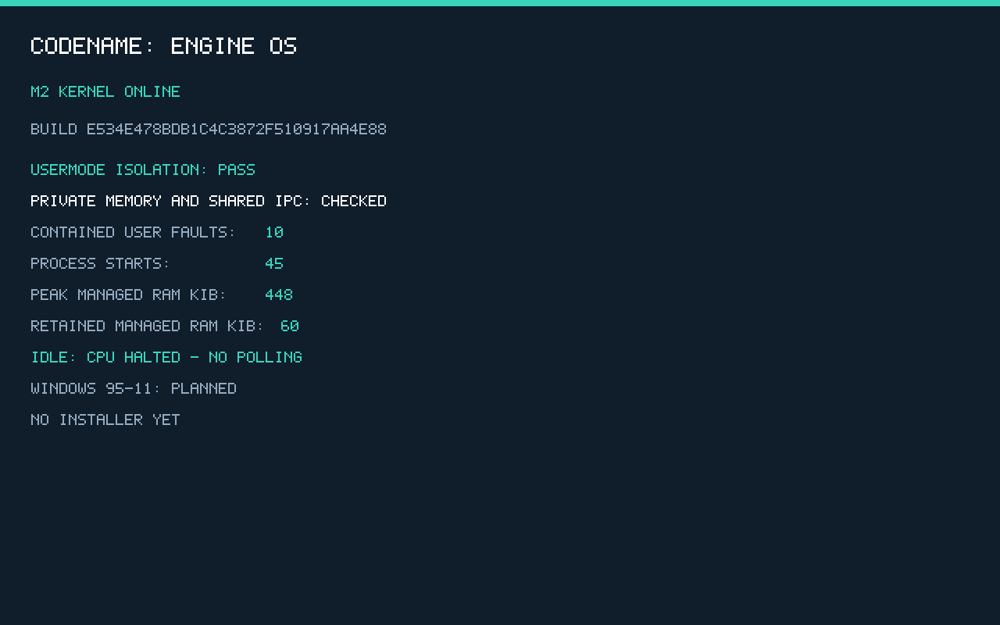

# M2 verification evidence

Scope: actual native ring-3 isolation/resource behavior and own-kernel boot in the pinned virtual platform. No installer or Windows application support. [Milestone instructions/limits](../../docs/milestones/m2.md).

- [Fresh aggregate acceptance](acceptance-results.json): build/source/artifact/document gates and exact suite counts.
- [Boot/isolation scenarios](boot-results.json): optical ISO, USB device, 64 MiB guest, stale-mapkey retry, kernel panic, invalid boot header and invalid ELF.
- [Persistent visual/idle/debugger](visual-results.json): normal-mode isolation completion, actual QEMU HLT state, sampled host CPU time, framebuffer and GDB handshake.
- [Build manifest](build-manifest.json): source/artifact hashes and identity.
- [Repository organization/language](repository-results.json): current English docs, links, root layout and script paths.
- [M0 regression](../M0/acceptance-results.json): the original 51 technical checks, relocated without changing their semantic scope.

Logs: [ISO](iso-smoke.log), [USB](usb-smoke.log), [64 MiB](iso-lowram.log), [2 GiB](iso-large-guest.log), [retry](iso-retry.log), [kernel panic](iso-panic.log), [bad header](iso-badboot.log), [bad ELF](iso-badelf.log), [normal idle](normal-iso.log), [symbolized panic](panic-symbol.txt).

Only PPM→PNG conversion is applied. Nine hostile user CPU faults plus one invalid user-return context must be isolated. Expected workload totals are 45 starts, 35 normal exits, ten contained failures and zero assertions; surviving processes and repeated fresh data verify isolation/cleanup. Every successful isolation scenario checks those totals and independent rights/IPC/pointer markers, not only a splash screen.

Reported managed peak/retained bytes exclude separately reported boot reservations; both are shown in the JSON. Firmware/device/framebuffer and host memory are not silently classified as kernel-owned pages. A 64 MiB guest test is not a universal minimum. The normal image ends in HLT; the reported short QEMU host-CPU interval is not a usable-desktop or power benchmark. Single-CPU/cooperative/native-only limits remain explicit.

Run `python tests/m2/verify.py`. Generated images/symbols stay under ignored build/dist directories; release assets are uploaded separately and remotely hash-checked. Historical M1 evidence remains bound to its release tag; M2 covers the inherited firmware/error routes using its own current build.

## Final measured sample

Build identity and exact values are in the linked reports. The final workload records 448 KiB peak managed pages, 60 KiB retained managed pages and 420 KiB retained boot allocations. Managed peak plus boot is 868 KiB; retained managed plus boot is 480 KiB. These totals exclude firmware/device/framebuffer and host memory. The final sampled two-second QEMU interval is about 0.78% of one host CPU, with actual HLT observed; this is not a desktop or power benchmark.

All eight boot/error scenarios, five visual/idle/debugger checks, five repository gates and 51 original M0 checks pass. The native workload adds 45 real process starts and 128 object reuse cycles inside each successful isolation scenario; those internal assertions are not miscounted as separate host test cases.
