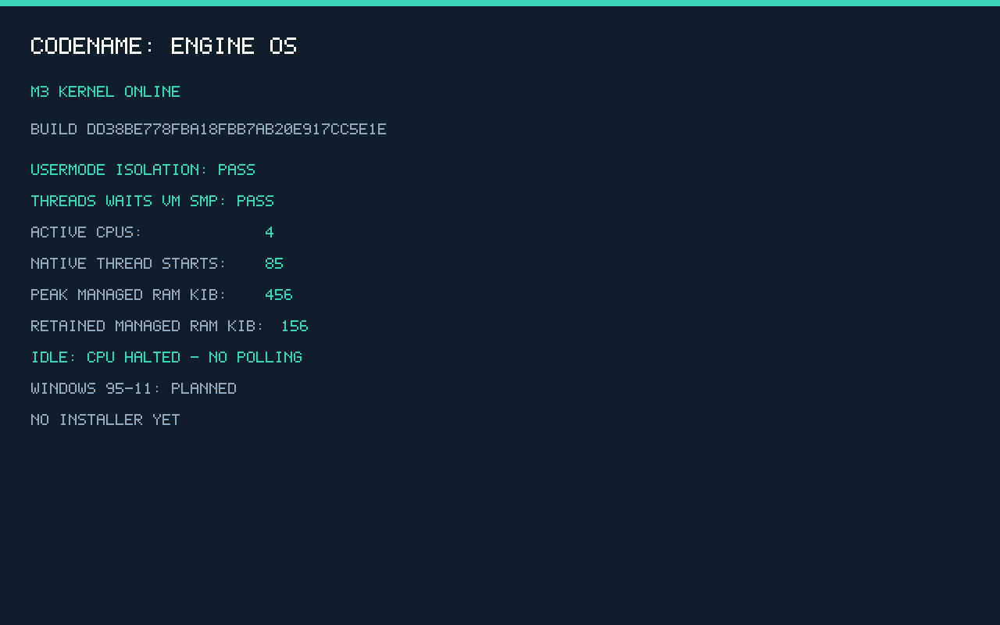

# M3 verification evidence

Scope: native x86-64 VM preemption, threads/TLS/x87/SSE, blocking waits/deadlines, anonymous reserve/commit/decommit/COW, bounded pressure/OOM and 1/2/4 active CPUs. This is not Windows application, installer, desktop or physical-hardware qualification. [Implementation and limits](../../docs/milestones/m3.md).

- [Fresh acceptance](acceptance-results.json): full scoped gate, provenance and suite counts.
- [Boot/runtime report](boot-results.json): 14 ISO/USB/RAM/SMP/repeat/error cases with exact resource, runtime and TSC measurements.
- [Visual/idle/debugger report](visual-results.json), [all CPU idle registers](idle-registers.log), [normal log](normal-iso.log), [screenshot](boot-screen.png).
- [Context-switch optimization and unchanged-benchmark comparison](history/context-switch-performance.md).
- [Additional VMware 1/2/4-CPU serial/runtime qualification](vmware/README.md).
- [Build provenance](build-manifest.json), [repository gates](repository-results.json), [M0 regressions](../M0/acceptance-results.json), [M2 regression](../M2/acceptance-results.json).

Each successful boot requires the inherited 47-start/37-exit/ten-fault workload and 85 M3 thread starts (73 exits, ten cancellations, two faults). Thread/handle quotas, page rollback, manual/auto events, mailbox waits, cancellation/close/timeouts, HPET catch-up, two CPU COW faults, one kernel-copy COW, one contained COW-OOM case, five pressure intervals and all-CPU native execution are checked. Concurrent allocation/TLB/timer work is required on each active CPU. A boot logo alone cannot pass.

Peak and retained managed pages, runtime-window peak, separate boot reservations and per-thread cost are reported. Dispatch TSC samples are emulator return-preparation timings, not a complete context-switch or hardware benchmark. Halt and CPU sampling are actual QEMU observations after all periodic timers stop; low guest RAM is not a universal product minimum.

Run `python tests/m3/verify.py`. The report must explicitly have `passed: true` and `full_m3_complete: true`, and all linked fresh gates must pass. The previous preemption alpha is historical; final artifacts are tied to the new release tag. An earlier failed timing ceiling and its revised deterministic-vs-SMP qualification are retained in [history](history/README.md). No raw host user paths or proprietary binaries are published. Generated images stay in ignored build/dist and are separately uploaded/hash-verified on GitHub.

## Final measured resource sample

The m3-v0.3.0 release QEMU cases recorded 456 KiB peak managed pages plus 692 KiB retained boot reservations (1148 KiB combined, excluding firmware/devices/framebuffer/host). Retained managed pages were 60/92/156 KiB for 1/2/4 active CPUs. Native thread metadata is 800 bytes, plus separate 4 KiB stack and 4 KiB TLS backing: 8992 bytes/thread before shared process/code costs. Fresh regression build IDs and exact memory/timing values are in the current reports; release-tag artifacts remain immutable.

At m3-v0.3.0 release the deterministic-clock and normal final QEMU cases recorded zero late ticks. Fresh regression lateness is reported directly and is not forced to that historical observation. The retained earlier failed development sample records 17. These are observations, not a hard real-time guarantee or hidden discarded failures. The release's additional VMware cases recorded zero late ticks and 688 KiB boot reservations in their own reports.
